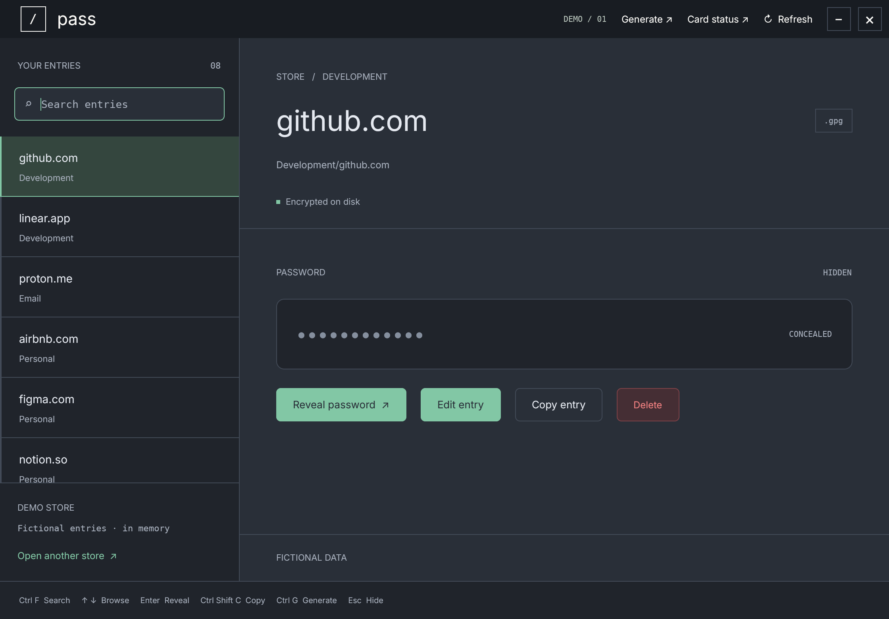
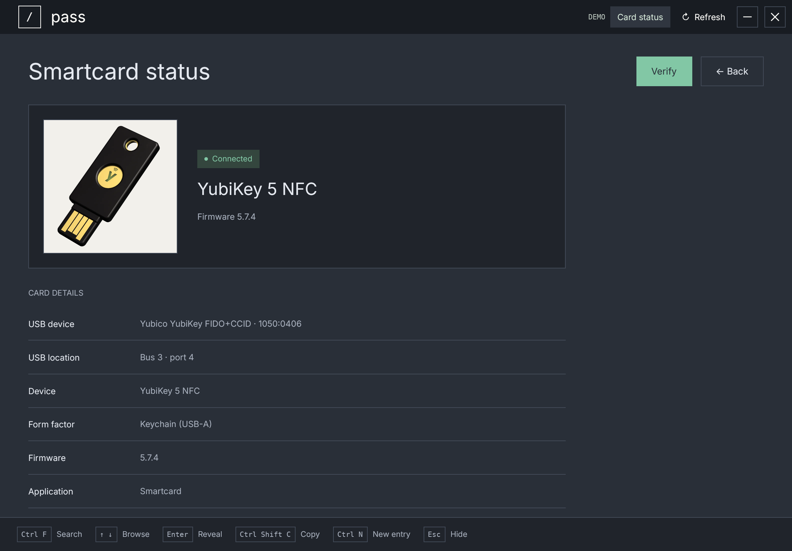
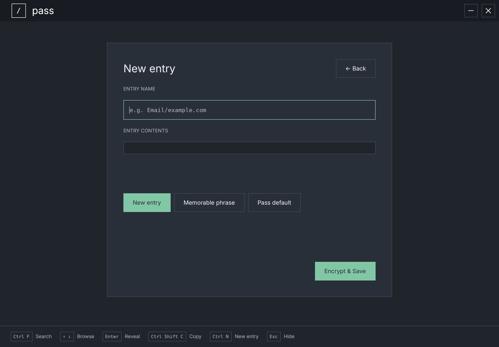

# gpui-pass

[](https://github.com/rickycodes/gpui-pass/actions/workflows/ci.yml)
[](https://github.com/rickycodes/gpui-pass/actions/workflows/release.yml)

A Rust/[GPUI](https://gpui.rs/) desktop client for existing or newly initialized [pass](https://www.passwordstore.org/) stores. Linux first, with a separate backend so other desktop platforms can be added without changing the store format.

**Status: v1.0.0 released.** Download the [Linux x86_64 release](https://github.com/rickycodes/gpui-pass/releases/tag/v1.0.0). The supported workflows, onboarding, YubiKey handling, artifact checksum, and provenance verification have been exercised. See the [roadmap](ROADMAP.md) for post-v1 work.

## Screenshots

### Entries



### YubiKey card status



### Compose



## Core capabilities

- Browse nested `.gpg` entries in an existing store.
- Initialize a new local store from existing GPG recipient IDs through a one-screen onboarding flow; no key management or `pass` CLI is required.
- Search entry and folder names without decrypting content.
- Explicit reveal: first-line password plus arbitrary remaining entry content.
- Copy the complete entry directly to the clipboard without displaying it.
- Press `Ctrl+Shift+C` to copy the selected entry without revealing it.
- Restore the prior clipboard item after `PASSWORD_STORE_CLIP_TIME` seconds (45 by default), unless another app has changed the clipboard first.
- Hide after 30 seconds, on selection/search changes, refresh, Escape, and window deactivation.
- Cancel pending reveals and reject obsolete or background reveal/copy results.
- Create entries in one composer with explicit New (manual), Pass default
  (pass-compatible random password generated on save), and Memorable phrase
  (editable generated content); manual and memorable text is encrypted exactly
  as entered. The composer stays open with cleared fields after a successful
  save, including confirmed replacements.
- Existing entry names warn before replacement and verify the stored revision
  has not changed before saving.
- Remove an individual encrypted entry after a confirmation prompt; folder deletion is not implemented.
- Folder picker, explicit `--store`, onboarding, and isolated `--demo`/`--onboarding-demo` modes.

Generated entries are encrypted by GnuPG to the recipients resolved from the nearest `.gpg-id` (or `PASSWORD_STORE_KEY`) and created without overwriting an existing entry. When recipients come from `.gpg-id` and `PASSWORD_STORE_SIGNING_KEY` is set, writes require a valid detached signature from one of its configured full fingerprints. The explicit `PASSWORD_STORE_KEY` override bypasses `.gpg-id` lookup, matching `pass`. A detected policy change cancels the write. The editor supports up to 16 KiB and 512 lines and rejects oversized input without truncating it. Saves detect changes to the encrypted entry since reveal and leave conflicting edits unsaved; the editor offers explicit overwrite or discard-and-reveal choices. A bounded per-entry lock in the user runtime directory serializes saves across `gpui-pass` instances. Other writers such as `pass` do not participate and can still race the final revision check and rename. Individual entries can be removed after confirmation; this does not erase Git history or backups. The random mode follows `pass` defaults: 25 characters from punctuation and alphanumeric characters, with `PASSWORD_STORE_GENERATED_LENGTH` and `PASSWORD_STORE_CHARACTER_SET` overrides. The character-set parser supports common POSIX classes and safe literal ASCII characters. Automatic Git commits/sync, export, and key management are deferred. Saving a generated password copies it to the clipboard automatically; the displayed generated password hides after 30 seconds, while its clipboard copy follows `PASSWORD_STORE_CLIP_TIME` and restores the previous clipboard contents. The bundled EFF Short Word List #2 is attributed in [assets/EFF-WORDLIST-LICENSE.md](assets/EFF-WORDLIST-LICENSE.md).

Copying a hidden entry decrypts it in the background and copies its complete contents, including all lines, without displaying it. If the entry is already revealed, copying reuses the in-memory contents instead of decrypting again. The app restores the prior clipboard item after `PASSWORD_STORE_CLIP_TIME` seconds (45 by default), matching `pass`'s default timeout, and shows the remaining time. If another app changes the clipboard before timeout, the app leaves the newer contents alone. Generated-password and editor-selection copies use the same policy. Normal app exit restores a tracked copy if it still owns the clipboard; crashes or forced termination cannot guarantee cleanup. Set the variable in the desktop launch environment to change the delay. Invalid or clock-overflowing values fall back to 45 seconds.

Manual hardware and signed-onboarding checks have been exercised on the
maintainer's setup. The [roadmap](ROADMAP.md) records completed v1 verification
and post-v1 follow-ups.

## Linux build and run

### Theme configuration

The app loads an optional TOML theme at `$XDG_CONFIG_HOME/gpui-pass/theme.toml`, or `~/.config/gpui-pass/theme.toml` when `XDG_CONFIG_HOME` is unset. Missing values inherit the built-in theme. Invalid or unknown values cause the file to be ignored and the built-in theme to be used. Copy [config/theme.example.toml](config/theme.example.toml) as a starting point. Colors use `#RRGGBB`; the translucent `selection` color uses `#RRGGBBAA`. Spacing and radius values are in GPUI logical pixels and are range checked. Changes apply after restarting the app.

Use a current stable Rust toolchain, GnuPG 2.2+, Wayland or X11, and Vulkan graphics support. Configure graphical pinentry through your normal `gpg-agent` setup. Running the client does not require the `pass` CLI. If the configured store is missing, the app offers to create a pass-compatible store using existing GPG recipients.

### Supported Linux baseline

The v1 release artifact is built and tested on Ubuntu 24.04 LTS, x86_64. The
desktop can run under either Wayland or X11; the release smoke test uses X11
through Xvfb and Mesa's software Vulkan driver, so CI does not require a
physical GPU. Other recent Linux distributions may work, but their package
names and graphics/pinentry setup are not release-gated. Future Linux releases
will also offer `gpui-pass-linux-x86_64.AppImage`, bundling the app's detected
shared-library dependencies and launcher metadata. Make it executable and run
it directly; GnuPG, pinentry, smartcard support, and graphics drivers remain
system requirements.

```sh
chmod +x gpui-pass-linux-x86_64.AppImage
./gpui-pass-linux-x86_64.AppImage
```

For the standalone archive on Ubuntu 24.04, install the runtime libraries and
graphical GnuPG pinentry:

```sh
sudo apt install \
  gnupg pinentry-gnome3 \
  libasound2t64 libfontconfig1 libfreetype6 libssl3t64 \
  libwayland-client0 libx11-xcb1 libxkbcommon-x11-0 libvulkan1
```

Use the pinentry package appropriate for the desktop environment instead of
`pinentry-gnome3` when necessary (for example, `pinentry-qt` on KDE). A
terminal-only pinentry is not sufficient for normal desktop use. GnuPG,
`gpg-agent`, and `scdaemon` use the user's existing configuration; the app
does not manage keys or start a separate agent.

Optional OpenPGP smartcard/YubiKey support uses the same GnuPG setup:

```sh
sudo apt install scdaemon
```

The card status details and local **Verify Device** action additionally use
the optional Python helpers:

```sh
sudo apt install python3-yubikey-manager python3-fido2 python3-cryptography
```

The app uses GnuPG's smartcard path and does not require `pcscd` for its
YubiKey flow. Follow the distribution's USB permissions guidance if the
current user cannot access the device.

### Dependency portability

GnuPG and its user-configured `gpg-agent`, graphical pinentry, and (for
smartcards) `scdaemon` are required system components. The app uses the
existing keyring and agent; bundling GnuPG would not replace the user's
key/agent setup or provide a suitable pinentry.

Python 3 and the libraries above are optional: they provide extra YubiKey
details and the **Verify Device** action. Without them, core password-store
and GnuPG workflows remain available, but those optional features do not.
`udevadm` and `gpg-connect-agent` support device/card watching, and `zenity`
provides the Linux folder picker; these are system integrations, not part of
the password-store format.

The AppImage bundles the app's detected shared-library dependencies and
launcher files, but does not bundle GnuPG, pinentry, smartcard support, device
permissions, or graphics drivers. Keep these as documented system
requirements. Replacing optional helpers to eliminate their runtime
dependencies would require maintaining equivalent native functionality.

### Launcher and task-switcher icon

Release archives include an XDG desktop entry and scalable icon that match
the window's `dev.gpui-pass` application ID. The AppImage carries those files
inside its bundle; installing the desktop entry into the user's applications
directory may still require an AppImage integration tool or manual setup. If
you install a locally built binary in `$HOME/.local/bin`, register the desktop
entry and icon from the repository root:

```sh
install -Dm644 packaging/dev.gpui-pass.desktop \
  "$HOME/.local/share/applications/dev.gpui-pass.desktop"
install -Dm644 assets/gpui-pass.svg \
  "$HOME/.local/share/icons/hicolor/scalable/apps/gpui-pass.svg"
```

The desktop session must be able to find `gpui-pass` through `PATH`.

The desktop is a separate Cargo package so security tests do not depend on GPUI:

```sh
# Fictional entries; no real store or GnuPG access
cargo run --manifest-path desktop/Cargo.toml -- --demo

# PASSWORD_STORE_DIR, falling back to ~/.password-store
cargo run --manifest-path desktop/Cargo.toml

# Step through onboarding without writing files or invoking GnuPG
cargo run --manifest-path desktop/Cargo.toml -- --onboarding-demo

# Explicit store and optional GnuPG executable
cargo run --manifest-path desktop/Cargo.toml -- \
  --store /path/to/password-store --gpg /usr/bin/gpg
```

GPUI is pinned to published version 0.2.2. Linux builds require native compiler, X11/Wayland, font, audio, and SSL development packages. A starting set on Ubuntu is:

```sh
sudo apt install build-essential clang cmake pkg-config libclang-dev \
  libasound2-dev libfontconfig1-dev libfreetype6-dev libssl-dev \
  libwayland-dev libx11-xcb-dev libxkbcommon-x11-dev libvulkan-dev
```

See [GPUI](https://gpui.rs/) and [Zed's Linux build documentation](https://zed.dev/docs/development/linux) for platform requirements. Both desktop and backend dependency lockfiles are included.

GPUI's archive dependency still uses `xattr 0.2.3`, which references the removed Linux `libc::ENOATTR` alias. The desktop uses a small [vendored compatibility patch](vendor/xattr/PATCH.md) selecting Linux/Android `ENODATA` while preserving macOS/BSD behavior. Current libc remains in use. The patch is selected automatically; do not edit Cargo's registry cache or apply the compiler's unrelated `ENOSTR` suggestion.

GPUI's macro dependency also needs a [one-line compatibility patch](vendor/proc-macro-error2/PATCH.md)
to make its public `proc_macro` re-export valid on future Rust versions.

If linking reports `unable to find library -lxkbcommon-x11`, install `libxkbcommon-x11-dev` (Ubuntu/Debian). Having the runtime `.so.0` installed alone is insufficient for a normal build.

GnuPG defaults to `/usr/bin/gpg`. `--gpg` requires an absolute executable path. The folder picker requires a working desktop portal; use `--store` if unavailable.

| Key | Action |
| --- | --- |
| Ctrl F | Focus search and select query |
| Up / Down | Previous / next entry |
| Enter | Reveal / hide selected entry |
| Escape | Hide and cancel reveal |
| Ctrl R | Refresh store |
| Tab | Switch search/navigation focus |
| Ctrl Q | Quit |
| F11 | Toggle fullscreen |

Drag the dark title bar to move the window. Double-click it to enter or leave fullscreen. The Refresh control remains independently clickable.

## Verification

GitHub Actions detects changed areas and runs the affected Rust checks, Python
helper tests, and disposable real `pass`/GnuPG integration fixture; use
`workflow_dispatch` to run every check. Compiler warnings, including dependency
future-incompatibility warnings, fail CI alongside Clippy warnings. The v1.0.0
release includes a Linux x86_64 archive, checksum, and GitHub artifact
provenance attestation. The public repository and its release assets are
available to everyone.

Before either release path, run `scripts/prepare-release.sh vMAJOR.MINOR.PATCH`
from a clean tracked worktree. It updates both Cargo package versions and
lockfiles, verifies them against the requested tag, and creates a commit with
the message `chore(release): prepare vMAJOR.MINOR.PATCH`. The script refuses
tracked changes and existing local tags. The workflow independently checks
that the selected commit's manifests and lockfiles match the release tag; it
does not modify the release commit. For a UI release, choose **Release → Run
workflow**, enter the same tag in `release_tag`, and select the commit created
by the script. For a pushed release, create and push a signed annotated tag
pointing to that commit. The workflow creates the GitHub Release only after
artifact verification and refuses an existing remote tag.

The published archive also receives a GitHub artifact provenance attestation.
After downloading it, verify the build origin with:

```sh
gh attestation verify gpui-pass-linux-x86_64.tar.gz \
  --repo rickycodes/gpui-pass
```

Anyone can verify this public repository's attestation with the GitHub CLI.

Pushed releases require a GitHub-verified signed annotated tag. Create one
with `git tag -s vX.Y.Z -m "Release vX.Y.Z"` using the configured YubiKey-backed
GPG key, inspect it with `git show --show-signature`, then push it. Unsigned or
lightweight tags are rejected before the build starts.

```sh
cargo test --locked
bash scripts/check-rust-warnings.sh
bash scripts/check-rust-warnings.sh --manifest-path desktop/Cargo.toml
cargo clippy --locked --all-targets -- -D warnings
cargo fmt --all --check
cargo fmt --manifest-path desktop/Cargo.toml --all --check

# Requires gpg, gpg-agent, pass, Python 3; uses disposable keys/store
bash scripts/test-pass-compat.sh

# Still required with package registry access
cargo build --manifest-path desktop/Cargo.toml
cargo clippy --manifest-path desktop/Cargo.toml --all-targets -- -D warnings
```

The integration fixture sets its own `GNUPGHOME` and `PASSWORD_STORE_DIR`, creates root and nested multi-recipient entries through `pass`, checks exact multiline plaintext in Rust, and checks unchanged ciphertext. It stops its own agent and removes its own temporary directory.

The release smoke verifier expects `xvfb-run` and validates a downloaded tarball with:

```sh
bash scripts/verify-release.sh \
  gpui-pass-linux-x86_64.tar.gz \
  gpui-pass-linux-x86_64.tar.gz.sha256
```

For a local visual smoke check, run `--demo` and use fictional data. The v1 manual pass covered keyboard/mouse/IME search, navigation, resizing, focus transitions, cancellation, timeout, and entry replacement on the maintainer's setup.

## YubiKey / OpenPGP smartcards

YubiKey support uses the same chain as an existing GnuPG-backed `pass` setup: `gpg → gpg-agent → scdaemon → OpenPGP card`. The client inherits `GNUPGHOME` and uses the existing keyring and card key stubs. It does not move, import, export, or recreate your private key, or start a separate managed agent.

When available, the card view also shows YubiKey model, firmware, and form factor
using the `ykman` Python library through the FIDO HID interface, plus the matching
USB bus/port location from Linux sysfs. This optional query requires Python 3,
the library, and access to the key's FIDO interface. It never falls back to
PC/SC, which can compete with GnuPG's built-in CCID driver after reconnection.
Serial numbers are not displayed. Other smartcards continue to use the details
reported by GnuPG.

**Verify Device** runs locally on the card status page. Touch the YubiKey when
it blinks; the app verifies a fresh FIDO U2F challenge signature and validates
the attestation certificate chain against bundled Yubico roots. It requires Linux,
Python's `fido2` and `cryptography` packages, OpenSSL 3, and an accessible FIDO HID
interface with U2F support. FIDO2-only devices report an unsupported result.
Verification uses no PC/SC connection or network request, asks for no PIN, and
discards the temporary non-discoverable credential and attestation response.
Unplugging or cancelling discards the result. The offline trust snapshot and
its provenance are documented in [assets/YUBICO-ATTESTATION.md](assets/YUBICO-ATTESTATION.md).

PIN entry belongs to your system pinentry. The app explicitly uses `--pinentry-mode ask`; it never requests a PIN, sends one over stdin, or selects loopback entry. Your agent/scdaemon configuration and hardware touch policy stay in effect. A compact status block with a subtle background gives PIN and security-key guidance during reveal and copy. Copy status appears in the shared bottom notification bar, so you can follow the system prompt and touch a blinking YubiKey without revealing the password. The 30-second display timer begins after successful reveal decryption, not while unlocking the card.

The helper follows allowlisted `--status-fd` events for pinentry launch, card insertion, card-busy progress, agent contention, and decryption. Only fixed application messages reach the UI; raw diagnostics and key/card metadata are discarded. GnuPG does not supply a universal touch-required event, and some versions/backends do not forward card-busy progress during private-key decryption. If no actionable status arrives after two seconds, the helper gives conditional guidance: **if your YubiKey is blinking, touch its gold contact**, and complete any open system prompt first. Card-busy guidance is conditional too; a busy card does not prove a touch is required. No competing card probes or global touch-detector service are used. See [GnuPG status documentation](https://raw.githubusercontent.com/gpg/gnupg/master/doc/DETAILS).

Your current `pass` setup is the intended prerequisite. A terminal-only pinentry may need a graphical equivalent for the desktop launcher. Ignoring `gpg.conf` does **not** ignore `gpg-agent.conf` or `scdaemon.conf`. [GnuPG smartcard documentation](https://www.gnupg.org/documentation/manuals/gnupg/gpg_002dcard.html)

YubiKey hardware behavior has been tested on Linux, including card insertion/removal, reveal, PIN and touch handling, and retry after reconnect.

The app follows your existing agent/card policy; it does not force a fresh PIN or touch for every reveal. Removing a card does not currently hide an entry already revealed in memory; normal hide/focus/timeout rules apply.

Card diagnostics are written automatically to `$XDG_STATE_HOME/gpui-pass/diagnostics.log`,
or `~/.local/state/gpui-pass/diagnostics.log` when `XDG_STATE_HOME` is unset.
The startup terminal output prints the actual path. Set `GPUI_PASS_LOG` to override it.
The log records timestamps, process/probe IDs, insertion generations, subprocess
timing, output byte counts, numeric GnuPG errors, retry decisions, and pauses for
reveal/save operations. It excludes entry contents, PINs, card serials, key
fingerprints, and raw subprocess output. Each log rotates at 1 MiB, keeping one
previous file (`diagnostics.log.1`); newly created files are readable only by the
current user. Events are also printed to stderr. Logs can be inspected directly
after reproducing a problem without copying terminal output.

Startup diagnostics also record the Vulkan device and whether it uses software
rendering (`software=true` means graphics run on the CPU). For resource-use
investigations, launch with `GPUI_PASS_PERF=1 cargo run --manifest-path desktop/Cargo.toml`
and leave the window idle. Every five seconds, `performance.sample` records the
number of app renders and timer ticks, plus the time spent building the render
tree (excluding layout, painting, and GPU work). An idle entries screen should
settle to zero renders; countdowns and loading animations intentionally redraw.
These counters contain no entry data. Development builds optimize dependencies
to reduce the cost of GPUI rendering; the first build after this setting changes
will recompile them. Use `--release` to measure the fully optimized application.

The desktop backports Blade's upstream Vulkan device-selection fix: PCI GPU
topology and Wayland/X11 detection replace the `/etc/prime-discrete` heuristic.
A stale flag otherwise made Intel-only systems fall back to llvmpipe. The patch
applies to development and release builds; see
[the patch notes](vendor/blade-graphics/GPUI-PASS-PATCH.md).

## Compatibility and future platforms

`src/` contains store traversal, GnuPG subprocess handling, zeroizing secret storage, and reveal lifecycle. `desktop/` contains GPUI, search input, actions, and styling.

The shared status types live in `src/operation.rs` (`OperationStatus`, `StatusKind`, `OperationProgress`); the desktop renders feedback in its bottom notification bar. Reveal, hidden copy, and save operations each receive a fresh, bounded latest-value reporter; workers publish application-owned static messages and the UI observes changes. Active prompts and app messages take priority over passive clipboard status. The composer shares the same footer. See the [roadmap](ROADMAP.md) for current validation status and remaining review work.

Existing stores require no migration, database, recipient changes, or new entry schema. The client uses `GNUPGHOME`, your normal keyring, and agent configuration. It deliberately ignores `gpg.conf` so configuration cannot redirect plaintext into files, and does not run extensions or accept `PASSWORD_STORE_GPG_OPTS`.

The store reader rejects symlinks, multiply linked files, traversal, backslashes, and non-UTF-8/control/bidirectional-formatting filenames. Unsupported filenames are omitted. Limits: 1 MiB decrypted text, 50,000 entries, 100,000 directory nodes, and 32 directory levels. Displayed content is capped separately.

Secure file access and process I/O currently use Unix APIs through `rustix`, with Linux-only process hardening gated separately. Non-Unix access fails closed. macOS still needs native build/pinentry, font, executable discovery, and shortcut validation. Native Windows needs reviewed reparse-point/file-handle and subprocess adapters plus GnuPG packaging. WSL is a separate option to investigate, not currently a supported target.

See [ROADMAP.md](ROADMAP.md) for planned work and [SECURITY.md](SECURITY.md) for the security boundary and limitations.

## AI disclosure

AI tools are used to assist with development and documentation. The maintainer is responsible for reviewing and maintaining the project.

## License

The project is licensed under the [MIT License](LICENSE). Third-party components and bundled assets may have separate license terms; retain their notices.
